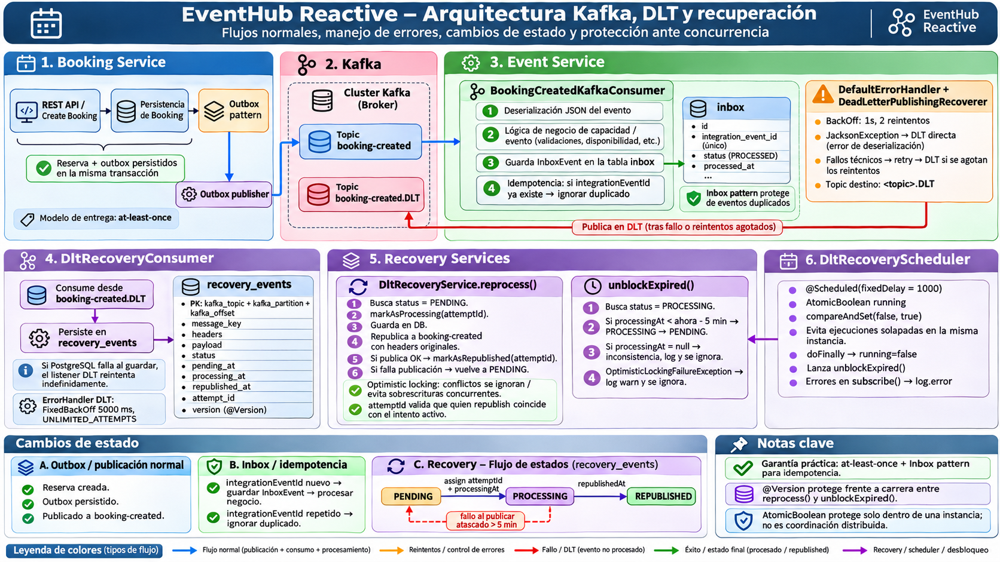

# EventHub Reactive

EventHub is a backend portfolio project for **event management and bookings**, built with **Java 21, Spring Boot 4.1, DDD and Hexagonal Architecture**. It deliberately combines a reactive Event Service with an imperative Booking Service to explore both programming models. **React and TypeScript are planned, not implemented.**

## 🎯 Project Goal

EventHub is a hands-on **Senior Java backend portfolio** that explores how to design, implement, test, and evolve a distributed event and booking platform. The emphasis is on **domain modeling, clean boundaries, concurrency, consistency, service communication, and failure recovery**, not simply making endpoints work.

The project intentionally uses **reactive** and **imperative** Spring applications side by side to demonstrate their trade-offs. The planned frontend (React / TypeScript), extended deployment automation, and further observability are tracked separately in the roadmap; they are **not presented as completed**.

## 🚀 Tech Stack

| Area | Technologies |
| --- | --- |
| Core | Java 21, Spring Boot 4.1, Maven |
| Event Service | Spring WebFlux, Project Reactor, Spring Data R2DBC |
| Booking Service | Spring MVC, Spring Data JPA, Hibernate, Flyway |
| Data | PostgreSQL 17 |
| API and integration | REST, OpenAPI, Spring RestClient, Spring Kafka, Spring JMS, IBM MQ |
| Reliability | Transactional Outbox, persistent Inbox, optimistic locking, synchronous compensation, Resilience4j |
| Testing | JUnit 5/6, Mockito, Testcontainers, WebTestClient, MockMvc, Karate (API E2E) |
| Local infrastructure | Docker Compose |

Additional technologies and planned work are tracked in the [roadmap](docs/ROADMAP.md).

## 🏗️ Architecture Overview

| Component | Responsibilities | Programming model |
| --- | --- | --- |
| **Event Service** (`:8080`) | Event lifecycle, capacity management, Kafka consumption and deduplication | Reactive: WebFlux / Reactor / R2DBC |
| **Booking Service** (`:8081`) | Booking lifecycle, capacity orchestration, persistence, asynchronous publication | Imperative: Spring MVC / JPA |

```text
Client
  | REST
  v
Booking Service (Spring MVC + JPA)
  |-- reserve/release capacity via REST --> Event Service (WebFlux + R2DBC)
  |-- bookings + outbox_events ---------> PostgreSQL (single local transaction)
  |-- OutboxKafkaScheduler -> Kafka ------> Event Service consumer -> R2DBC Inbox
  |-- OutboxIBMMQScheduler -> IBM MQ ----> Booking Service JMS consumer -> JPA Inbox
                                            | failures / rollback
                                            v
                                       BOOKING.BACKOUT.Q
```

**Integration boundaries:** REST reserve/release handles business capacity. The Booking Service creates **two broker-specific Outbox records** (`KAFKA` and `IBMMQ`) together with the Booking in one local PostgreSQL transaction; independent schedulers publish the same integration-event payload (including one shared `integrationEventId`) to Kafka and IBM MQ. Neither consumer reserves capacity again. **The two external broker deliveries are not atomic** and may be duplicated.

The domain and application layers follow **DDD and ports/adapters**. Infrastructure contains HTTP controllers, persistence adapters, messaging adapters and Spring configuration.

## 🔄 Kafka, Dead Letter Topic & Recovery Architecture

EventHub implements an event-driven communication mechanism between **Booking Service** and **Event Service**, using Apache Kafka, the Transactional Outbox pattern, an idempotent Inbox and a persistent Dead Letter Topic (DLT) recovery mechanism.

The architecture is designed to handle message delivery failures, temporary database outages, duplicate messages and concurrent recovery attempts.

### Architecture Diagram



### Message Processing Flow

**1. Transactional Outbox — Booking Service**

When a booking is created, the application persists the booking and its integration events within the same local database transaction.

An asynchronous Outbox scheduler publishes the Kafka event to the `booking-created` topic.

**2. Kafka Consumer & Idempotent Inbox — Event Service**

Event Service consumes the integration event and persists its `integrationEventId` in the Inbox.

The Inbox prevents duplicate processing when Kafka redelivers an event.

**3. Dead Letter Topic — Failure Handling**

Failed messages are handled using Spring Kafka's `DefaultErrorHandler`.

After the configured retries are exhausted, `DeadLetterPublishingRecoverer` redirects the message to `booking-created.DLT`.

**4. Persistent DLT Recovery**

`DltRecoveryConsumer` persists failed messages in PostgreSQL's `recovery_events` table, preserving their original Kafka key, payload and headers.

The recovery service supports controlled republication of pending events.

### Recovery State Machine

```text
                  reprocess()
                      │
                      ▼
    ┌─────────┐    claim + attemptId    ┌────────────┐
    │ PENDING │ ──────────────────────► │ PROCESSING │
    └─────────┘                         └────────────┘
         ▲                                    │
         │                                    │ Kafka ACK
         │                                    ▼
         │                              ┌─────────────┐
         │                              │ REPUBLISHED │
         │                              └─────────────┘
         │
         └────────────── PROCESSING
               Kafka publication failure
               OR processingAt expired (> 5 min)
```

Recovery operations use **optimistic locking (`@Version`)** and an **`attemptId`** to protect against conflicting updates and stale recovery attempts.

A scheduled process detects events stuck in `PROCESSING` for more than five minutes and returns them to `PENDING`.

The scheduler uses an `AtomicBoolean` to prevent overlapping executions within the same application instance.

Records with inconsistent state, such as `PROCESSING` with a null `processingAt`, are logged and excluded from automatic unlocking.

### Delivery Guarantees

- **At-least-once delivery:** duplicate messages remain possible.
- **Idempotent Inbox:** protects against repeated processing of the same integration event.
- **Optimistic locking:** prevents concurrent recovery attempts from silently overwriting each other.
- **Persistent recovery:** failed messages remain available for subsequent processing.
- **Scheduled unlocking:** prevents expired `PROCESSING` records from remaining blocked indefinitely.
- **No distributed transaction:** Kafka publication and PostgreSQL state updates are not atomic.

The scheduler unlocks expired recovery records; it does **not** automatically invoke `reprocess()`. Republication is currently triggered separately.

### Verification

The recovery mechanism is covered by unit and integration tests using **JUnit, Mockito, PostgreSQL Testcontainers, Kafka Testcontainers and Toxiproxy**.

Verified scenarios include successful republication, publication failures, duplicate protection, optimistic locking conflicts, expired processing recovery and scheduler error handling.

**Latest verification:** `mvn verify` — GREEN.

📖 **[Detailed Kafka Architecture & Recovery Documentation](docs/KAFKA.md)**

## 📍 Current Situation Overview

| Area | Current state | Next concerns |
| --- | --- | --- |
| **Event Service** | ✅ WebFlux/R2DBC, Event lifecycle, optimistic capacity management | Broader automated cross-service failure tests |
| **Booking Service** | ✅ Spring MVC/JPA, API-first booking flow, Flyway, transactional persistence | Durable distributed reconciliation |
| **REST integration** | ✅ Capacity reservation/release and best-effort compensation; resilience for availability reads | Robust handling of ambiguous remote outcomes |
| **Kafka** | ✅ Transactional Outbox/Inbox, DLT persistence, PostgreSQL-outage retries and manually triggered DLT replay with key/payload/headers (Testcontainers + Toxiproxy) | Multi-instance recovery coordination, offset-commit and complete two-service E2E tests |
| **IBM MQ** | ✅ Broker-specific Transactional Outbox relay, JMS consumer + JPA Inbox, rollback/backout, broker-backed Testcontainers tests | Full failure-path automation and relay coordination |
| **Frontend / deployment** | ⬜ React / TypeScript and extended deployment work planned | See roadmap |

The status describes **capabilities demonstrated in this project**, not production-readiness. The [roadmap](docs/ROADMAP.md) contains the complete checklist.

## 🖼️ Technical Picture

### Event Service: reactive request path

```text
HTTP client
   ↓
EventController                 inbound HTTP adapter
   ↓
CreateEventUseCase             application input port
   ↓
CreateEventService             application service
   ↓
Event / Capacity / Money       pure Java domain model
   ↓
EventRepository                application output port
   ↓
R2dbcEventRepositoryAdapter   persistence adapter
   ↓
PostgreSQL 17                  R2DBC / optimistic locking
   ↓
Mono<Event> → EventResponse    WebFlux HTTP response
```

### Booking creation and integration events

```text
POST /api/bookings
   ↓
CompensatingBookingUseCase
   ├── REST: reserve capacity ──────────────────────→ Event Service
   ↓
TransactionalBookingUseCase (@Transactional)
   ├── BookingRepository → bookings                ┐
   └── OutboxRepository  → outbox_events           ┘ one local commit
   ↓
Outbox records (same transaction): KAFKA + IBMMQ
  |-- OutboxKafkaScheduler → Kafka topic: booking-created
  |      → Event Service @KafkaListener → PostgreSQL/R2DBC Inbox
  |
  `-- OutboxIBMMQScheduler → JmsTemplate → BOOKING.CREATED.Q
         → BookingCreatedMqConsumer → Booking Service PostgreSQL/JPA Inbox
         → on repeated failures: BOOKING.BACKOUT.Q
```

**Why these boundaries matter:** DDD protects domain invariants and ports/adapters keep transport concerns out of application rules. The Booking + two Outbox rows are one local transaction; broker sends are asynchronous/independent, at least once, and not an atomic distributed operation. JMS consumer deduplication is tested against a separate PostgreSQL Testcontainer.

### 🏛️ Domain model

```text
Event (Aggregate Root)                  Booking (Aggregate Root)
 ├── EventId                              ├── BookingId
 ├── EventName                            ├── EventId / UserId
 ├── Capacity                              └── PENDING / CONFIRMED / CANCELLED
 ├── Money
 └── publish / cancel / reservePlaces / releasePlaces
```

Value Objects enforce validity; aggregate methods control legal state changes. Detailed rules, examples and design choices live in [DDD](docs/DDD.md) and [Hexagonal Architecture](docs/HEXAGONAL.md).

## ✅ Implemented Features

- **Events:** creation, publication, querying, capacity reservation/release, domain invariants and optimistic locking.
- **Bookings:** API-first creation and lookup, `PENDING` / `CONFIRMED` / `CANCELLED` lifecycle, active-booking uniqueness and transactional JPA persistence.
- **Service communication:** synchronous REST capacity reservation with best-effort compensation; availability checks with timeout, Retry, Circuit Breaker and Bulkhead.
- **Kafka:** Booking and Outbox persisted atomically; scheduled producer; Event Service consumer with PostgreSQL Inbox for duplicate deliveries.
- **IBM MQ:** Independent Outbox relay, JMS producer/consumer, JPA Inbox deduplication, transactional rollback/redelivery, `BOTHRESH`/backout queue, and Testcontainers integration tests.
- **API end-to-end tests:** Karate scenarios exercise live Event creation/publication, Booking creation and capacity updates, invalid-request 400 and capacity-exhaustion 409.

## 🧪 Testing and Guarantees

| Scope | Evidence | Limitations |
| --- | --- | --- |
| Domain and API | Unit, controller and adapter tests | See topic-specific documentation |
| Persistence | PostgreSQL/Testcontainers tests for JPA, Outbox and reactive Inbox | No distributed ACID transaction |
| Two-service REST | Local Karate API E2E scenarios against live Booking and Event services (capacity decrement, sold-out 409, invalid 400), plus manual and mocked HTTP tests | Depends on running services; durable compensation/reconciliation and cross-service failure injection pending |
| Kafka | Transactional Outbox/Inbox tests, DLT/error-handler tests, database-backed DLT replay integration tests including original headers and competing claim protection | Complete automated two-service broker E2E, offset failure verification and production-grade multi-instance recovery pending |
| IBM MQ | Automated MQ + PostgreSQL Testcontainers tests (JMS round trip, Inbox persistence, duplicate delivery); manual rollback/backout/browse checks | Automated failure-path tests and multi-instance Outbox coordination pending |

Successful local Booking + Outbox commit does not guarantee instant Kafka delivery. The Outbox design is **at least once**, and consumers must account for duplicates. IBM MQ failures are routed to a separate backout queue after the configured threshold in the tested JMS setup.

## ⚙️ Running Locally

The project contains two independently run Spring Boot services and separate local infrastructure. Karate E2E API tests in `booking-service` require both services reachable at their configured base URLs (normally `http://localhost:8081` and `http://localhost:8080`); these values are supplied by `src/test/resources/karate-config.js`. Configuration and prerequisites vary by service; consult the relevant module setup and documentation before starting. Infrastructure examples:

```powershell
docker compose -f compose.kafka.yaml up -d
docker compose -f compose.ibmmq.yaml up -d
```

The IBM MQ configuration is in `ibmmq/init.mqsc`; apply it from the repository root if needed:

```powershell
Get-Content.\ibmmq\init.mqsc | docker exec -i eventhub-ibmmq runmqsc QM1
```

Use local environment variables for credentials; do not commit real secrets. **Do not routinely rerun `DEFINE... REPLACE` against queues containing messages.** See [IBM MQ documentation](docs/IBMMQ.md) for setup, privileges and verification.

## 📚 Technical Documentation

| Topic | Document |
| --- | --- |
| Domain modeling and invariants | [DDD](docs/DDD.md) |
| Ports, adapters and dependency inversion | [Hexagonal Architecture](docs/HEXAGONAL.md) |
| R2DBC, JPA, locking and consistency | [Persistence and Consistency](docs/PERSISTENCE_CONSISTENCY.md) |
| Reactor and WebFlux | [Reactive Programming](docs/REACTIVE.md) |
| REST, compensation and cross-service testing | [Microservices Communication](docs/MICROSERVICES_COMMUNICATION.md) |
| Retry, Circuit Breaker and Bulkhead | [Resilience](docs/RESILIENCE.md) |
| Transactional Outbox and Inbox | [Kafka](docs/KAFKA.md) |
| Spring JMS, redelivery and Backout Queue | [IBM MQ](docs/IBMMQ.md) |
| Karate API end-to-end testing | [Karate E2E Testing](docs/KARATE_E2E_TESTING.md) |
| Completed and pending work | [Roadmap](docs/ROADMAP.md) |

## 🗺️ Roadmap

The [roadmap](docs/ROADMAP.md) separates completed work from planned features, including Kafka broker-backed failure-path/offset tests and DLT recovery, stronger IBM MQ failure-path automation, frontend development and deployment topics. The Git commit history records *when* the work was performed.

## 👨‍💻 Author

**Rubén Marín** — Senior Java Backend Developer.

This repository is a practical portfolio and learning project focused on modern Java backend engineering, software architecture, testing, distributed systems and service integration.


### Kafka DLT recovery

Event Service now persists `booking-created.DLT` records to `recovery_events` and can manually replay pending entries to `booking-created`. Recovery uses `PENDING → PROCESSING → REPUBLISHED`, `@Version` optimistic locking, a stable event payload/`integrationEventId`, and `KafkaHeadersCodec` for restoring headers. Kafka ACK precedes the final database status update. Tests reported green for PostgreSQL interruption/recovery with Toxiproxy and five service integration paths (success, Kafka failure, version conflict, competing claim, post-ACK database failure), including verification by an independent Kafka consumer of `correlationId` header bytes. See [KAFKA.md](docs/KAFKA.md).

The Event Service also runs `DltRecoveryScheduler` (Spring `@Scheduled`) to call `DltRecoveryService.unblockExpired()`. Records stuck in `PROCESSING` for more than 300 seconds are returned to `PENDING`; the next **separate invocation of `reprocess()`** can republish them. A per-instance `AtomicBoolean` prevents overlapping scheduler executions and `doFinally()` releases it even after an error. Records with `PROCESSING` and `processingAt = null` are logged and skipped as inconsistent. `DltRecoveryUnblockIT` and `DltRecoverySchedulerTest` cover these behaviors; the latest `mvn verify` run was green.

This is **at-least-once**, not exactly-once: crashes after broker ACK can leave `PROCESSING`; timeout-based unlock may result in a duplicate publish. Production-grade multi-instance scheduling, stronger fencing/leases, monitoring, and explicit offset tests remain pending.
