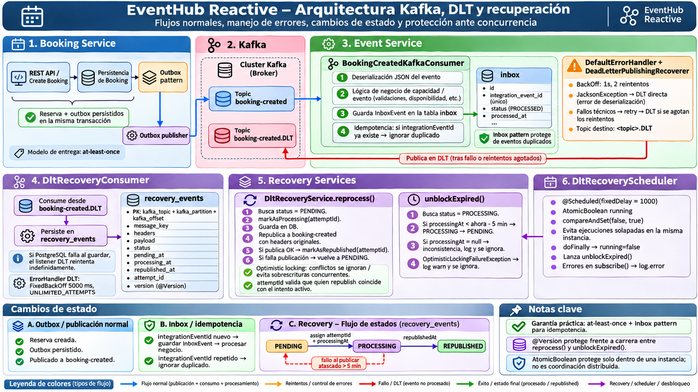

# EventHub Reactive

EventHub is a backend portfolio project for **event management, bookings, payments and AI-assisted interactions**, built with **Java 21, Spring Boot 4.1, DDD and Hexagonal Architecture**. It combines a reactive Event Service and AI Assistant Service with imperative Booking and Payment services. **Payment Service domain and PostgreSQL persistence are implemented; its Kafka integration and the distributed payment Saga are still planned.** The AI Assistant provides prompt/response and SSE streaming, and has verified OpenAI Tool Calling for live availability queries through Event Service; Booking Service integration remains planned. React and TypeScript are planned, not implemented.

## 🎯 Project Goal

EventHub is a hands-on **Senior Java backend portfolio** that explores how to design, implement, test, and evolve a distributed event and booking platform. The emphasis is on **domain modeling, clean boundaries, concurrency, consistency, service communication, and failure recovery**, not simply making endpoints work.

The project intentionally uses **reactive** and **imperative** Spring applications side by side to demonstrate their trade-offs. The planned frontend (React / TypeScript), extended deployment automation, and further observability are tracked separately in the roadmap; they are **not presented as completed**.

## 🚀 Tech Stack

| Area | Technologies |
| --- | --- |
| Core | Java 21, Spring Boot 4.1, Maven |
| Event Service | Spring WebFlux, Project Reactor, Spring Data R2DBC |
| Booking Service | Spring MVC, Spring Data JPA, Hibernate, Flyway |
| Payment Service | Spring MVC, Spring Data JPA, Hibernate, Flyway |
| AI Assistant Service | Spring AI, OpenAI ChatClient, Spring WebFlux, Reactor, SSE, Spring Profiles |
| Data | PostgreSQL 17 |
| API and integration | REST, OpenAPI, Spring RestClient, Spring Kafka, Spring JMS, IBM MQ |
| Reliability | Transactional Outbox, persistent Inbox, optimistic locking, synchronous compensation, Resilience4j |
| Testing | JUnit 5/6, Mockito, Testcontainers, WebTestClient, MockMvc, Karate (API E2E) |
| Local infrastructure | Docker Compose |

Additional technologies and planned work are tracked in the [roadmap](docs/ROADMAP.md).

## 🏗️ Architecture Overview

EventHub now contains **four independent Spring Boot services**, including the new AI Assistant Service. Payment Service is already present with a tested domain model and JPA/PostgreSQL persistence; the payment messaging flow shown below is the **target architecture**, not a completed integration. The AI Assistant now queries Event Service availability through a read-only Spring AI tool; it does not yet perform Booking Service operations.

| Component | Responsibilities | Programming model | Status |
| --- | --- | --- | --- |
| **Event Service** (`:8080`) | Event lifecycle, capacity management, Kafka consumption and deduplication | Reactive: WebFlux / Reactor / R2DBC | ✅ Implemented |
| **Booking Service** (`:8081`) | Booking lifecycle, capacity reservation and compensation, Outbox publication | Imperative: Spring MVC / JPA | ✅ Existing booking flow |
| **Payment Service** (`:8082`) | Payment aggregate, payment persistence; future payment-request processing and result publication | Imperative: Spring MVC / JPA | 🟡 Domain and persistence implemented; Kafka integration pending |
| **AI Assistant Service** (`:8083`) | AI prompts, SSE streaming, fake/real adapters and live Event availability via Tool Calling | Reactive HTTP: WebFlux / Reactor; Spring AI | ✅ Read-only Event Service tool integration verified; Booking integration pending |

### AI Assistant Service — Spring AI and Event Service integration

The independent `ai-assistant-service` demonstrates **Spring AI with Hexagonal Architecture**. Its inbound HTTP adapter (`AiController`) invokes the `AskAiUseCase` port; `AiService` delegates to `AiModelPort`; infrastructure supplies either `SpringAiAdapter` (real OpenAI `ChatClient`) or `FakeAiAdapter` (simulated responses). `AiConfiguration` registers application and adapter beans explicitly and selects model adapters with Spring profiles (`dev` for fake, `prod` for real). The real `ChatClient` registers `EventTools`, a read-only Spring AI tool that uses a separate `GetAvailableSeatsUseCase` and `EventAvailabilityPort` to query Event Service through `WebClient`.

```text
Client
  | POST /api/v1/ai/ask                (JSON → Mono<String>)
  | POST /api/v1/ai/ask/stream         (JSON → text/event-stream)
  v
AiController                         HTTP inbound adapter
  |
  v
AskAiUseCase → AiService             application layer
                    |
                    v
                AiModelPort          outbound port
                    ^
            +-------+-------+
            |               |
       FakeAiAdapter   SpringAiAdapter
         (dev)             (prod)
       fixed text       ChatClient ↔ OpenAI
       + timed Flux             |
                         EventTools (@Tool)
                              |
                      GetAvailableSeatsUseCase
                              |
                      EventAvailabilityService
                              |
                       EventAvailabilityPort
                              |
                  RestEventAvailabilityAdapter
                              | WebClient GET /events/{id}
                              v
                      Event Service (:8080)
```

- **Synchronous endpoint:** `POST /api/v1/ai/ask` accepts `{"question":"..."}`. Its blocking application call is wrapped with `Mono.fromCallable(...).subscribeOn(Schedulers.boundedElastic())`, keeping that call off WebFlux event-loop threads.
- **Streaming endpoint:** `POST /api/v1/ai/ask/stream` accepts the same JSON body and responds with `text/event-stream` using `Flux<String>`. Local testing of the fake adapter returned HTTP 200 with SSE-formatted chunks; the PowerShell client buffered the displayed response, so this alone does not measure live chunk arrival times.
- **Fake model:** a no-cost `FakeAiAdapter` uses fixed text and `Flux.just(...).delayElements(...)` to simulate streaming. In the `prod` profile, `SpringAiAdapter` uses Spring AI's `.call()` and `.stream()` APIs to invoke a configured OpenAI model.
- **Tool Calling:** `EventTools.getAvailableSeats(String eventId)` uses `@Tool` and `@ToolParam` descriptions, validates the event UUID and returns availability provided by Event Service. `RestEventAvailabilityAdapter` maps upstream 404/503 and connection errors to application-specific failures. The tool uses a bounded blocking wait for the reactive lookup.
- **Tests:** `AiServiceTest` uses Mockito for application delegation. `SpringAiAdapterTest` verifies mocked model tool invocation and the returned tool value in the follow-up prompt; `RestEventAvailabilityAdapterTest` uses WireMock and `StepVerifier` for HTTP success/failure scenarios. `EventToolsIT` passed against a running Event Service. A live OpenAI request was observed invoking the tool and returning 999990 seats (2026-11-16). The live test is environment-dependent; comprehensive automated end-to-end testing, controller tests and streaming edge-case tests remain pending.
- **Security:** real keys must not be committed. Use the `OPENAI_API_KEY` placeholder and a locally ignored `.env`, environment variable, or deployment secrets. `.env.example` may document the required variable without a real value.

**Not implemented yet:** natural-language event discovery/search, Booking Service actions or queries, structured output, RAG, AI authorization, comprehensive tool error responses, and production-grade resilience/observability. Tool Calling currently supports a read-only availability query by known Event UUID.

### Existing integration flow — Event + Booking

```text
Client
  | REST
  v
Booking Service (Spring MVC + JPA)
  |-- reserve/release capacity via REST --> Event Service (WebFlux + R2DBC)
  |-- bookings + outbox_events ---------> PostgreSQL (single local transaction)
  |-- OutboxKafkaScheduler -> Kafka ------> Event Service consumer -> R2DBC Inbox
  |-- OutboxIBMMQScheduler -> IBM MQ ----> Booking Service JMS consumer -> JPA Inbox
                                            | failures / rollback
                                            v
                                       BOOKING.BACKOUT.Q
```

**Existing guarantees:** Booking creation and its two broker-specific Outbox records (`KAFKA`, `IBMMQ`) share one local PostgreSQL transaction. Broker publication is asynchronous, independent and **at least once**; duplicate deliveries are possible. The current booking flow is **not yet conditional on payment confirmation**.

### Planned integration flow — Booking + Payment Saga

```text
Client
  | 1. Create / publish event
  v
Event Service (:8080)
  ^
  | 3. Reserve capacity (REST)           8b. Release capacity on payment failure
  |                                                ^
  +--------------- Booking Service (:8081) --------+
                       ^    |
  2. Create booking -->|    | 4. Booking PENDING + PaymentRequested Outbox
                            v
                           Kafka  [PLANNED PAYMENT FLOW]
                            |
                            | 5. PaymentRequested
                            v
                     Payment Service (:8082)
                     Inbox + Payment + Outbox
                            |
                            | 6. PaymentCompleted / PaymentFailed
                            v
                           Kafka
                            |
                            v
                     Booking Service Inbox
                            |
                +-----------+-----------+
                |                       |
       7a. Payment success       7b. Payment failure
       Booking CONFIRMED          Booking CANCELLED
                                  + capacity release
```

**Saga design (planned):** Booking Service coordinates the workflow. It reserves capacity and creates a `PENDING` booking, then requests payment asynchronously. Payment Service processes `PaymentRequested` and emits `PaymentCompleted` or `PaymentFailed`; Booking Service confirms the booking or compensates by releasing capacity. The design will use a transactional Inbox/Outbox on the payment path, a stable `paymentRequestId` for business idempotency, and local transactions rather than distributed ACID.

**Implementation boundary:** `Payment`, `PaymentId`, `BookingId`, `PaymentRequestId`, `Money`, `CreatePaymentUseCase`, the JPA adapter, Flyway migration, and PostgreSQL/Testcontainers tests have been implemented and reported green. **Kafka payment consumers, payment-result producers, the Booking Saga coordinator and cross-service payment E2E tests have not yet been implemented.**

See [Payment Service README](payment-service/README.md), [Payment Architecture](payment-service/docs/ARCHITECTURE.md) and [Payment Roadmap](payment-service/docs/ROADMAP.md).

The domain and application layers follow **DDD and ports/adapters**. Infrastructure contains HTTP controllers, persistence adapters, messaging adapters and Spring configuration.

## 🔄 Kafka, Dead Letter Topic & Recovery Architecture

EventHub implements an event-driven communication mechanism between **Booking Service** and **Event Service**, using Apache Kafka, the Transactional Outbox pattern, an idempotent Inbox and a persistent Dead Letter Topic (DLT) recovery mechanism.

The architecture is designed to handle message delivery failures, temporary database outages, duplicate messages and concurrent recovery attempts.

### Architecture Diagram



### Message Processing Flow

**1. Transactional Outbox — Booking Service**

When a booking is created, the application persists the booking and its integration events within the same local database transaction.

An asynchronous Outbox scheduler publishes the Kafka event to the `booking-created` topic.

**2. Kafka Consumer & Idempotent Inbox — Event Service**

Event Service consumes the integration event and persists its `integrationEventId` in the Inbox.

The Inbox prevents duplicate processing when Kafka redelivers an event.

**3. Dead Letter Topic — Failure Handling**

Failed messages are handled using Spring Kafka's `DefaultErrorHandler`.

After the configured retries are exhausted, `DeadLetterPublishingRecoverer` redirects the message to `booking-created.DLT`.

**4. Persistent DLT Recovery**

`DltRecoveryConsumer` persists failed messages in PostgreSQL's `recovery_events` table, preserving their original Kafka key, payload and headers.

The recovery service supports controlled republication of pending events.

### Recovery State Machine

```text
                  reprocess()
                      │
                      ▼
    ┌─────────┐    claim + attemptId    ┌────────────┐
    │ PENDING │ ──────────────────────► │ PROCESSING │
    └─────────┘                         └────────────┘
         ▲                                    │
         │                                    │ Kafka ACK
         │                                    ▼
         │                              ┌─────────────┐
         │                              │ REPUBLISHED │
         │                              └─────────────┘
         │
         └────────────── PROCESSING
               Kafka publication failure
               OR processingAt expired (> 5 min)
```

Recovery operations use **optimistic locking (`@Version`)** and an **`attemptId`** to protect against conflicting updates and stale recovery attempts.

A scheduled process detects events stuck in `PROCESSING` for more than five minutes and returns them to `PENDING`.

The scheduler uses an `AtomicBoolean` to prevent overlapping executions within the same application instance.

Records with inconsistent state, such as `PROCESSING` with a null `processingAt`, are logged and excluded from automatic unlocking.

### Delivery Guarantees

- **At-least-once delivery:** duplicate messages remain possible.
- **Idempotent Inbox:** protects against repeated processing of the same integration event.
- **Optimistic locking:** prevents concurrent recovery attempts from silently overwriting each other.
- **Persistent recovery:** failed messages remain available for subsequent processing.
- **Scheduled unlocking:** prevents expired `PROCESSING` records from remaining blocked indefinitely.
- **No distributed transaction:** Kafka publication and PostgreSQL state updates are not atomic.

The scheduler unlocks expired recovery records; it does **not** automatically invoke `reprocess()`. Republication is currently triggered separately.

### Verification

The recovery mechanism is covered by unit and integration tests using **JUnit, Mockito, PostgreSQL Testcontainers, Kafka Testcontainers and Toxiproxy**.

Verified scenarios include successful republication, publication failures, duplicate protection, optimistic locking conflicts, expired processing recovery and scheduler error handling.

**Latest verification:** `mvn verify` — GREEN.

📖 **[Detailed Kafka Architecture & Recovery Documentation](docs/KAFKA.md)**

## 📍 Current Situation Overview

| Area | Current state | Next concerns |
| --- | --- | --- |
| **Event Service** | ✅ WebFlux/R2DBC, Event lifecycle, optimistic capacity management | Broader automated cross-service failure tests |
| **Booking Service** | ✅ Spring MVC/JPA, API-first booking flow, Flyway, transactional persistence | Adapt booking lifecycle for payment Saga |
| **Payment Service** | 🟡 Payment domain, Money/identity value objects, CreatePayment use case, JPA/PostgreSQL and Testcontainers integration tests | Kafka PaymentRequested consumer, transactional Inbox/Outbox and payment-result publication |
| **AI Assistant Service** | ✅ Spring AI ChatClient, hexagonal ports/adapters, REST/SSE, real OpenAI tool invocation and Event availability via WebClient; mock and live integration checks | Booking integration, natural-language search, deterministic full E2E, controller tests, access control and tool error policies |
| **Payment Saga** | ⬜ Planned; not yet connected to Booking Service | Orchestration, payment confirmation, compensation, business idempotency and E2E tests |
| **REST integration** | ✅ Capacity reservation/release and best-effort compensation; resilience for availability reads | Robust handling of ambiguous remote outcomes |
| **Kafka** | ✅ Transactional Outbox/Inbox, DLT persistence, PostgreSQL-outage retries and manually triggered DLT replay with key/payload/headers (Testcontainers + Toxiproxy) | Multi-instance recovery coordination, offset-commit and complete two-service E2E tests |
| **IBM MQ** | ✅ Broker-specific Transactional Outbox relay, JMS consumer + JPA Inbox, rollback/backout, broker-backed Testcontainers tests | Full failure-path automation and relay coordination |
| **Frontend / deployment** | ⬜ React / TypeScript and extended deployment work planned | See roadmap |

The status describes **capabilities demonstrated in this project**, not production-readiness. The [roadmap](docs/ROADMAP.md) contains the complete checklist.

## 🖼️ Technical Picture

### Event Service: reactive request path

```text
HTTP client
   ↓
EventController                 inbound HTTP adapter
   ↓
CreateEventUseCase             application input port
   ↓
CreateEventService             application service
   ↓
Event / Capacity / Money       pure Java domain model
   ↓
EventRepository                application output port
   ↓
R2dbcEventRepositoryAdapter   persistence adapter
   ↓
PostgreSQL 17                  R2DBC / optimistic locking
   ↓
Mono<Event> → EventResponse    WebFlux HTTP response
```

### Booking creation and integration events

```text
POST /api/bookings
   ↓
CompensatingBookingUseCase
   ├── REST: reserve capacity ──────────────────────→ Event Service
   ↓
TransactionalBookingUseCase (@Transactional)
   ├── BookingRepository → bookings                ┐
   └── OutboxRepository  → outbox_events           ┘ one local commit
   ↓
Outbox records (same transaction): KAFKA + IBMMQ
  |-- OutboxKafkaScheduler → Kafka topic: booking-created
  |      → Event Service @KafkaListener → PostgreSQL/R2DBC Inbox
  |
  `-- OutboxIBMMQScheduler → JmsTemplate → BOOKING.CREATED.Q
         → BookingCreatedMqConsumer → Booking Service PostgreSQL/JPA Inbox
         → on repeated failures: BOOKING.BACKOUT.Q
```

**Why these boundaries matter:** DDD protects domain invariants and ports/adapters keep transport concerns out of application rules. The Booking + two Outbox rows are one local transaction; broker sends are asynchronous/independent, at least once, and not an atomic distributed operation. JMS consumer deduplication is tested against a separate PostgreSQL Testcontainer.

### 🏛️ Domain model

```text
Event (Aggregate Root)                  Booking (Aggregate Root)
 ├── EventId                              ├── BookingId
 ├── EventName                            ├── EventId / UserId
 ├── Capacity                              └── PENDING / CONFIRMED / CANCELLED
 ├── Money
 └── publish / cancel / reservePlaces / releasePlaces
```

Value Objects enforce validity; aggregate methods control legal state changes. Detailed rules, examples and design choices live in [DDD](docs/DDD.md) and [Hexagonal Architecture](docs/HEXAGONAL.md).

## ✅ Implemented Features

- **Events:** creation, publication, querying, capacity reservation/release, domain invariants and optimistic locking.
- **Bookings:** API-first creation and lookup, `PENDING` / `CONFIRMED` / `CANCELLED` lifecycle, active-booking uniqueness and transactional JPA persistence.
- **Service communication:** synchronous REST capacity reservation with best-effort compensation; availability checks with timeout, Retry, Circuit Breaker and Bulkhead.
- **Kafka:** Booking and Outbox persisted atomically; scheduled producer; Event Service consumer with PostgreSQL Inbox for duplicate deliveries.
- **IBM MQ:** Independent Outbox relay, JMS producer/consumer, JPA Inbox deduplication, transactional rollback/redelivery, `BOTHRESH`/backout queue, and Testcontainers integration tests.
- **API end-to-end tests:** Karate scenarios exercise live Event creation/publication, Booking creation and capacity updates, invalid-request 400 and capacity-exhaustion 409.
- **Spring AI:** Read-only tool calling fetches current Event Service availability by UUID through a hexagonal application port and WebClient adapter; live OpenAI invocation and tool logs verified locally.

## 🧪 Testing and Guarantees

| Scope | Evidence | Limitations |
| --- | --- | --- |
| Domain and API | Unit, controller and adapter tests | See topic-specific documentation |
| Persistence | PostgreSQL/Testcontainers tests for JPA, Outbox and reactive Inbox | No distributed ACID transaction |
| Two-service REST | Local Karate API E2E scenarios against live Booking and Event services (capacity decrement, sold-out 409, invalid 400), plus manual and mocked HTTP tests | Depends on running services; durable compensation/reconciliation and cross-service failure injection pending |
| Kafka | Transactional Outbox/Inbox tests, DLT/error-handler tests, database-backed DLT replay integration tests including original headers and competing claim protection | Complete automated two-service broker E2E, offset failure verification and production-grade multi-instance recovery pending |
| IBM MQ | Automated MQ + PostgreSQL Testcontainers tests (JMS round trip, Inbox persistence, duplicate delivery); manual rollback/backout/browse checks | Automated failure-path tests and multi-instance Outbox coordination pending |
| AI Assistant | Mocked tool-calling sequence, WireMock HTTP adapter tests and a live Event Service `EventToolsIT`; real OpenAI tool call confirmed in logs | Live tests require running dependencies; stable full E2E, access control and robust tool error handling pending |

Successful local Booking + Outbox commit does not guarantee instant Kafka delivery. The Outbox design is **at least once**, and consumers must account for duplicates. IBM MQ failures are routed to a separate backout queue after the configured threshold in the tested JMS setup.

## ⚙️ Running Locally

The project contains four independently run Spring Boot services (Payment Service and AI Assistant Service have incomplete integrations) and separate local infrastructure. The existing Karate E2E API tests in `booking-service` require Event and Booking services reachable at their configured base URLs (normally `http://localhost:8081` and `http://localhost:8080`); these values are supplied by `src/test/resources/karate-config.js`. Payment Service runs on `http://localhost:8082` and uses a separate PostgreSQL database (`paymentdb`, local port `5434`). Payment-to-Booking Kafka integration is not yet available. The AI Assistant runs locally on `http://localhost:8083`, exposes `POST /api/v1/ai/ask` and `POST /api/v1/ai/ask/stream`, and can run with fake responses under the `dev` profile. To ask the real model for available seats, Event Service must be reachable at the configured `eventhub.event-service.base-url` (locally `http://localhost:8080`), and the user question must include a known Event UUID. To use the real OpenAI-backed adapter, configure the `prod` profile and provide `OPENAI_API_KEY` securely; the OpenAI starter may still initialize when a fake adapter is active, so verify startup credentials and auto-configuration separately. Configuration and prerequisites vary by service; consult the relevant module setup and documentation before starting. Infrastructure examples:

```powershell
docker compose -f compose.kafka.yaml up -d
docker compose -f compose.ibmmq.yaml up -d
```

The IBM MQ configuration is in `ibmmq/init.mqsc`; apply it from the repository root if needed:

```powershell
Get-Content.\ibmmq\init.mqsc | docker exec -i eventhub-ibmmq runmqsc QM1
```

Use local environment variables for credentials; do not commit real secrets. **Do not routinely rerun `DEFINE... REPLACE` against queues containing messages.** See [IBM MQ documentation](docs/IBMMQ.md) for setup, privileges and verification.

## 📚 Technical Documentation

| Topic | Document |
| --- | --- |
| Domain modeling and invariants | [DDD](docs/DDD.md) |
| Ports, adapters and dependency inversion | [Hexagonal Architecture](docs/HEXAGONAL.md) |
| R2DBC, JPA, locking and consistency | [Persistence and Consistency](docs/PERSISTENCE_CONSISTENCY.md) |
| Reactor and WebFlux | [Reactive Programming](docs/REACTIVE.md) |
| REST, compensation and cross-service testing | [Microservices Communication](docs/MICROSERVICES_COMMUNICATION.md) |
| Retry, Circuit Breaker and Bulkhead | [Resilience](docs/RESILIENCE.md) |
| Transactional Outbox and Inbox | [Kafka](docs/KAFKA.md) |
| Spring JMS, redelivery and Backout Queue | [IBM MQ](docs/IBMMQ.md) |
| Karate API end-to-end testing | [Karate E2E Testing](docs/KARATE_E2E_TESTING.md) |
| Completed and pending work | [Roadmap](docs/ROADMAP.md) |
| Payment Service overview | [Payment README](payment-service/README.md) |
| Payment domain, Saga design and integration boundaries | [Payment Architecture](payment-service/docs/ARCHITECTURE.md) |
| Payment implementation milestones | [Payment Roadmap](payment-service/docs/ROADMAP.md) |
| AI assistant implementation | [AI Assistant README](ai-assistant-service/README.md) |

## 🗺️ Roadmap

The [roadmap](docs/ROADMAP.md) separates completed work from planned features, including Kafka broker-backed failure-path/offset tests, stronger IBM MQ failure-path automation, the Payment Service and planned payment Saga, the Spring AI tool-calling integration (Event availability verified; Booking features pending), frontend development and deployment topics. The Git commit history records *when* the work was performed.

## 👨‍💻 Author

**Rubén Marín** — Senior Java Backend Developer.

This repository is a practical portfolio and learning project focused on modern Java backend engineering, software architecture, testing, distributed systems and service integration.


### Kafka DLT recovery

Event Service now persists `booking-created.DLT` records to `recovery_events` and can manually replay pending entries to `booking-created`. Recovery uses `PENDING → PROCESSING → REPUBLISHED`, `@Version` optimistic locking, a stable event payload/`integrationEventId`, and `KafkaHeadersCodec` for restoring headers. Kafka ACK precedes the final database status update. Tests reported green for PostgreSQL interruption/recovery with Toxiproxy and five service integration paths (success, Kafka failure, version conflict, competing claim, post-ACK database failure), including verification by an independent Kafka consumer of `correlationId` header bytes. See [KAFKA.md](docs/KAFKA.md).

The Event Service also runs `DltRecoveryScheduler` (Spring `@Scheduled`) to call `DltRecoveryService.unblockExpired()`. Records stuck in `PROCESSING` for more than 300 seconds are returned to `PENDING`; the next **separate invocation of `reprocess()`** can republish them. A per-instance `AtomicBoolean` prevents overlapping scheduler executions and `doFinally()` releases it even after an error. Records with `PROCESSING` and `processingAt = null` are logged and skipped as inconsistent. `DltRecoveryUnblockIT` and `DltRecoverySchedulerTest` cover these behaviors; the latest `mvn verify` run was green.

This is **at-least-once**, not exactly-once: crashes after broker ACK can leave `PROCESSING`; timeout-based unlock may result in a duplicate publish. Production-grade multi-instance scheduling, stronger fencing/leases, monitoring, and explicit offset tests remain pending.
