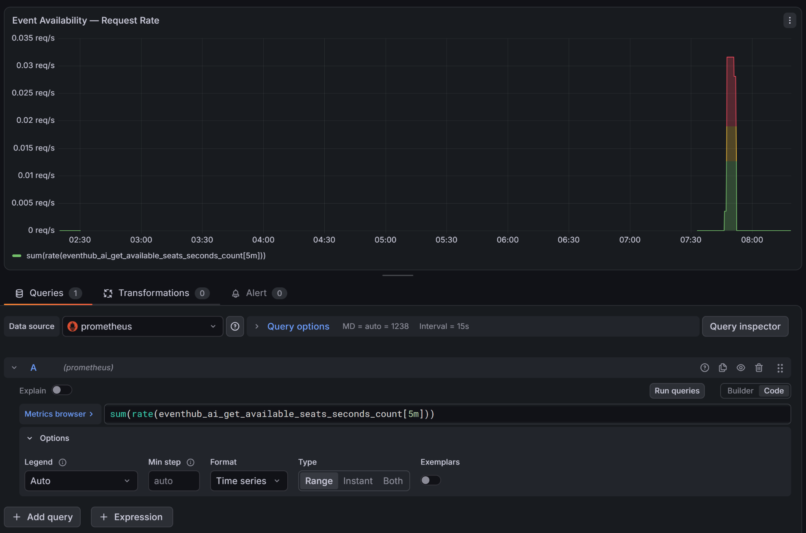

# EventHub Observability

Local observability stack for **EventHub Reactive**, developed and verified incrementally. It provides metrics through **Micrometer / Spring Boot Actuator → Prometheus → Grafana** and distributed tracing through **Micrometer Tracing / OpenTelemetry → Tempo → Grafana**.

> **Scope:** This is a local development and portfolio setup, not a production-ready monitoring deployment. The evidence below comes from manual runs and focused tests; it is not a claim that every EventHub service is instrumented.

## Architecture

```text
AI Assistant Service (:8083)                    Event Service (:8080)
  Spring Boot Actuator                             HTTP server tracing
  Micrometer Observations                          OpenTelemetry exporter
  Micrometer Tracing + OTel                         │
        │                                           │
        ├── GET /actuator/prometheus                │
        │         ▲                                 │
        │     Prometheus (scrapes)                  │
        │         │                                 │
        │         └───────────────────┐             │
        │                             ▼             │
        │                          Grafana          │
        │                             ▲             │
        └── OTLP /v1/traces ──→ Tempo ←──────────────┘
```

The AI Assistant calls Event Service through Spring Boot's configured `WebClient.Builder`. W3C trace context is propagated so the outbound HTTP client span and Event Service HTTP server span appear in the **same trace**.

## Repository files

```text
eventhub-reactive/
├── observability/
│   ├── docker-compose.yml       # Grafana, Tempo and Prometheus
│   ├── tempo.yaml               # OTLP HTTP receiver, local trace storage
│   ├── prometheus.yml          # Metric scraping jobs
│   └── grafana-datasources.yaml # Tempo datasource provisioning
└── docs/
    └── OBSERVABILITY.md        # This guide
```

The Compose and configuration files above are maintained separately from the application services. The exact container image tags and settings are defined in the checked-out files.

## Start the stack

Requirements: Docker Engine / Docker Desktop and the relevant Spring Boot services running locally.

From `observability/`:

```powershell
docker compose up -d
docker compose ps
```

Local interfaces:

| Component | URL / endpoint | Purpose |
| --- | --- | --- |
| Grafana | <http://localhost:3000> | Explore metrics and traces, dashboards |
| Prometheus | <http://localhost:9090> | Query metrics and inspect scrape targets |
| Prometheus targets | <http://localhost:9090/targets> | Confirm target is `UP` |
| Tempo query HTTP | <http://localhost:3200> | Trace backend; used internally by Grafana |
| OTLP HTTP ingestion | `http://localhost:4318/v1/traces` | Receive application traces |
| AI Actuator | <http://localhost:8083/actuator/metrics> | In-process Micrometer meter listing |
| AI Prometheus endpoint | <http://localhost:8083/actuator/prometheus> | Prometheus text exposition |

For this local setup, the Grafana credentials configured in Compose are intended only for local access. Change default credentials and restrict ports before any shared deployment. **Do not commit real credentials, API keys, or local telemetry data.**

### Docker networking

Grafana and Prometheus run in the same Compose network, so Grafana should use `http://prometheus:9090`, **not** `http://localhost:9090`. Grafana accesses Tempo with `http://tempo:3200`.

Prometheus runs in Docker while the AI Assistant runs on the Windows host, so `prometheus.yml` scrapes `host.docker.internal:8083` at `/actuator/prometheus` (Docker Desktop). If the application moves into Docker or to Linux, adjust the target and networking accordingly.

## Application configuration

The AI Assistant uses Spring Boot 4.1.x, Spring AI 2.x and the following dependencies:

```xml
<dependency>
    <groupId>org.springframework.boot</groupId>
    <artifactId>spring-boot-starter-actuator</artifactId>
</dependency>
<dependency>
    <groupId>org.springframework.boot</groupId>
    <artifactId>spring-boot-starter-opentelemetry</artifactId>
</dependency>
<dependency>
    <groupId>io.micrometer</groupId>
    <artifactId>micrometer-registry-prometheus</artifactId>
</dependency>
```

Relevant `application.yaml` settings (merge into the existing blocks, rather than duplicating them):

```yaml
spring:
  application:
    name: ai-assistant-service
  reactor:
    context-propagation: auto

management:
  endpoints:
    web:
      exposure:
        include: health,info,metrics,prometheus
  tracing:
    sampling:
      probability: 1.0          # development only
  otlp:
    metrics:
      export:
        enabled: false         # Prometheus scrapes metrics instead
  opentelemetry:
    tracing:
      export:
        otlp:
          endpoint: http://localhost:4318/v1/traces

logging:
  pattern:
    correlation: "[traceId=%X{traceId:-},spanId=%X{spanId:-}] "
```

The Event Service must also have tracing instrumentation, an appropriate `spring.application.name`, and trace export configured to Tempo to appear as a second service within the same trace. In the verified setup, its displayed service name was `eventhub-reactive`.

**Why metrics export is disabled:** the OpenTelemetry starter otherwise tried to publish OTLP metrics to `http://localhost:4318/v1/metrics`, producing connection errors while no metrics receiver was configured there. Metrics are instead exposed on Actuator and scraped by Prometheus. Disabling this exporter does **not** disable tracing.

The `1.0` sampling probability retains all traces for development; reduce it as appropriate outside local testing. Avoid exporting request prompts, event identifiers or secrets as unrestricted trace attributes.

## Custom observation: availability lookup

`EventTools.getAvailableSeats()` creates an observation named `eventhub.ai.get_available_seats` around the **actual availability use-case invocation**, including the blocking bridge to the Event Service request. Placing the call inside `Observation.observe(...)` makes the outbound WebClient span a child of the tool observation.

Its bounded `outcome` tag classifies operations:

| `outcome` | `error` label | Meaning |
| --- | --- | --- |
| `success` | `none` | Availability returned |
| `not_found` | `EventNotFoundException` | Event UUID valid but not present; HTTP 404 |
| `error` | e.g. `EventServiceUnavailableException` | Technical downstream failure; HTTP 503 |

The exception continues to propagate to the HTTP exception handler. In traces, an expected `not_found` may still be marked **error** because the exception escapes the observation; the `outcome` attribute provides a separate classification. Invalid UUID validation currently happens **before** this observation, so invalid UUIDs do not increment this custom meter.

Focused `EventToolsTest` cases use a `SimpleMeterRegistry`, `ObservationRegistry` and `DefaultMeterObservationHandler` to verify the three metric label combinations and an invalid UUID case without a running Tempo or Event Service.

## Query metrics

1. Run an availability request through `POST http://localhost:8083/api/v1/ai/ask` with the `dev` / `FakeAiAdapter` profile and an existing event UUID.
2. Inspect <http://localhost:8083/actuator/prometheus>; search for `eventhub_ai_get_available_seats`.
3. Verify the scrape target is `UP` at <http://localhost:9090/targets>.
4. In Grafana Explore select the **Prometheus** data source, use Code mode, and run a PromQL expression.

The observation appears as Prometheus summary series including:

```promql
eventhub_ai_get_available_seats_seconds_count
```

Requests per second (five-minute moving rate):

```promql
sum(rate(eventhub_ai_get_available_seats_seconds_count[5m]))
```

Request rate by outcome:

```promql
sum by (outcome) (rate(eventhub_ai_get_available_seats_seconds_count[5m]))
```

Average availability lookup duration in seconds (five-minute window):

```promql
sum(rate(eventhub_ai_get_available_seats_seconds_sum[5m]))
/
sum(rate(eventhub_ai_get_available_seats_seconds_count[5m]))
```

Technical-failure rate (excluding `not_found`):

```promql
sum(rate(eventhub_ai_get_available_seats_seconds_count{outcome="error"}[5m]))
```

### Grafana example — Event Availability request rate

The following screenshot shows the **Event Availability — Request Rate** time-series panel being configured in Grafana with the Prometheus data source:



The panel uses this PromQL expression:

```promql
sum(rate(eventhub_ai_get_available_seats_seconds_count[5m]))
```

- **Metric source:** the Micrometer `eventhub.ai.get_available_seats` observation, exported by Actuator and scraped by Prometheus.
- **Unit:** requests per second (`req/s`). The chart shows a short burst of availability lookups followed by a return toward zero.
- **Interpretation:** `rate(...[5m])` measures the average per-second change over a rolling five-minute window; it does **not** display raw request totals or one bar per invocation.
- **Limitations:** the screenshot demonstrates a working query in Grafana's panel editor; it does not establish that a complete dashboard has been saved or provisioned as code.

Prometheus needs enough scrape samples in the query range for `rate()`; an idle service or recently started process may yield empty or flat results. The Prometheus target was verified `UP`, and Grafana successfully queried the Prometheus API. A full version-controlled dashboard is still in progress.

## Inspect traces

1. In Grafana Explore select the **Tempo** data source, switch to **Trace ID** query, and paste a `traceId` from an AI Assistant log.
2. A verified successful availability trace showed this hierarchy:

```text
ai-assistant-service: POST /api/v1/ai/ask
└── eventhub.ai.get_available_seats
    └── ai-assistant-service: HTTP GET
        └── eventhub-reactive: GET /events/{id}
```

3. Request a nonexistent event UUID: the custom span shows `outcome=not_found`, an `EventNotFoundException` and its stack trace.
4. Stop the downstream Event Service temporarily and make the request again: `outcome=error` appears on the custom span when the downstream call fails.

These success/not-found/unavailable scenarios were manually confirmed in Tempo with trace context across **two services**. The verification is not an automated full-stack tracing integration test.

## Troubleshooting

| Symptom | Check |
| --- | --- |
| Grafana cannot query `localhost:9090` | Set Grafana's Prometheus URL to `http://prometheus:9090` on the Compose network |
| Prometheus target `DOWN` | Check the service is running at `8083`, Docker Desktop's `host.docker.internal`, and `/actuator/prometheus` |
| Missing custom metric | Execute `getAvailableSeats` at least once after startup; verify Actuator's Prometheus endpoint first |
| Empty `traceId` / `spanId` logs | Check tracing starter and Maven reload, Reactor context propagation, active trace and log correlation settings |
| OTLP metrics connection refused | Disable `management.otlp.metrics.export.enabled` when using Prometheus scraping |
| Trace visible but only one service | Enable/export tracing in Event Service and ensure cross-service `traceparent` propagation |
| No rate data | Widen time range, check scrape samples and generate new requests |

## Remaining work

- Build and version-control complete Grafana dashboards (request rate, average/tail latency, outcome/error breakdown).
- Establish SLIs/SLOs, alert rules and production-appropriate retention, access controls, secret management and sampling.
- Extend telemetry consistently to Booking and Payment services and test context propagation across messaging (Kafka / IBM MQ).
- Add trace/metric correlation tests and review treatment of expected 404s versus infrastructure failures.
- Consider structured logs and an optional log backend (e.g. Loki); not included in the current verified setup.
