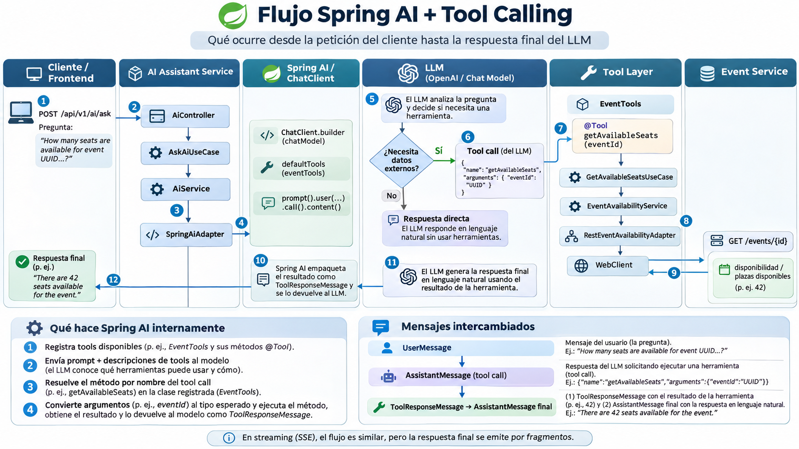

# Spring AI — EventHub Reactive

> Technical guide to the AI Assistant integration in EventHub. This document describes the implementation and tests discussed during development; it is not a claim of production readiness.

## 1. Purpose and scope

`ai-assistant-service` is an independent Java 21 / Spring Boot 4.1.x microservice using Spring AI 2.0.1 and Spring WebFlux. It demonstrates how to keep model-specific code behind hexagonal ports while exposing a synchronous question endpoint and a streaming SSE endpoint.

**Implemented:** OpenAI-backed and fake adapters, model selection by configuration, `ChatClient`, read-only Spring AI tool calling to Event Service, typed SSE, provider error translation, tests for streaming and cancellation, and Micrometer observations for event availability.

**Not yet implemented:** event search from natural-language descriptions, Booking Service actions, production authentication/authorization, comprehensive tool-error policy, RAG, and full cost controls. `prod` currently selects the real model adapter; it does not imply production readiness.

## 2. Architectural boundaries

```text
HTTP client
  | POST /api/v1/ai/ask  or  /api/v1/ai/ask/stream
  v
AiController                         infrastructure / inbound
  v
AskAiUseCase -> AiService           application
  v
AiModelPort                         application / outbound
  ^
  +--------------------+
  |                    |
FakeAiAdapter       SpringAiAdapter  infrastructure / outbound
(simulated)         ChatClient -> OpenAI API
                        |
                 tool request, if selected by model
                        v
                   EventTools (@Tool)
                        v
                 GetAvailableSeatsUseCase
                        v
                 EventAvailabilityService
                        v
                 EventAvailabilityPort
                        v
                 RestEventAvailabilityAdapter
                        v
                 WebClient -> Event Service GET /events/{id}
```

`AiService` depends on `AiModelPort`, not Spring AI APIs. Infrastructure handles model selection, external HTTP and provider-specific exceptions. The LLM **requests** a tool call; Spring AI executes the Java method. The LLM cannot execute Java methods directly.

## 3. Spring AI configuration and model selection

The project's Maven properties include:

```xml
<spring-ai.version>2.0.1</spring-ai.version>
```

The Spring AI OpenAI starter supplies the model integration:

```xml
<dependency>
    <groupId>org.springframework.ai</groupId>
    <artifactId>spring-ai-starter-model-openai</artifactId>
</dependency>
```

In this project's Spring AI 2.x configuration, the model is selected using **`spring.ai.openai.chat.model`**:

```yaml
spring:
  application:
    name: ai-assistant-service
  profiles:
    active: dev
  ai:
    openai:
      api-key: ${OPENAI_API_KEY}
      chat:
        model: ${OPENAI_MODEL:gpt-5-nano}
    tools:
      throw-exception-on-error: false
```

- **`dev` / any profile other than `prod`:** `FakeAiAdapter` via `@Profile("!prod")` for token-free experiments.
- **`prod`:** `SpringAiAdapter` via `@Profile("prod")` for actual API requests, subject to provider billing and quotas.
- Never commit an API key. A fake adapter does not necessarily prevent OpenAI starter auto-configuration; verify credential requirements separately.
- Model availability and pricing can change: consult [OpenAI API pricing](https://platform.openai.com/docs/pricing) before hardcoding cost estimates.

## 4. Prompt/response endpoint

`POST /api/v1/ai/ask` accepts a JSON request such as:

```json
{"question":"How many seats are available for event 0ebbca7e-87bb-4c1d-915c-676b59ffe329?"}
```

The application use case returns a `String`. The WebFlux controller wraps the blocking model call:

```java
return Mono.fromCallable(() -> askAiUseCase.ask(request.question()))
        .subscribeOn(Schedulers.boundedElastic());
```

This protects the WebFlux event-loop thread from the blocking call; **it does not make the OpenAI SDK invocation non-blocking**. The real adapter calls `ChatClient.prompt().user(prompt).call()`. Using `.chatResponse()` instead of `.content()` also makes response metadata available, including token usage when reported by the model/provider.

## 5. Spring AI tool calling: available seats

### Visual flow

The following diagram summarizes the full Spring AI + tool-calling sequence, from the HTTP request received by `AiController` to the final natural-language response generated by the LLM.



**What the diagram highlights:**
- The client sends `POST /api/v1/ai/ask` with a natural-language question.
- `AiController`, `AskAiUseCase`, `AiService`, and `SpringAiAdapter` delegate the request to Spring AI's `ChatClient`.
- `ChatClient` sends the prompt and the registered tool definitions (`defaultTools(eventTools)`) to the LLM.
- The LLM decides whether it can answer directly or whether it needs external data.
- If external data is needed, the LLM returns a **tool call** such as `getAvailableSeats({eventId: ...})`.
- Spring AI resolves the tool by name, invokes `EventTools.getAvailableSeats(...)`, converts the arguments, and executes the underlying use case.
- `EventTools` delegates to `GetAvailableSeatsUseCase`, which reaches Event Service through `EventAvailabilityService`, `RestEventAvailabilityAdapter`, and `WebClient`.
- The tool result is wrapped as a `ToolResponseMessage` and sent back to the LLM.
- The LLM uses that tool result to generate the final natural-language answer.
- In streaming mode (`/api/v1/ai/ask/stream`), the same logical flow applies, but the final response is emitted progressively as SSE chunks.

The real adapter registers `EventTools` with `ChatClient.defaultTools(eventTools)`. The tool is read-only and accepts a UUID **string**. It validates the UUID, calls `GetAvailableSeatsUseCase`, and returns an integer availability count.

```text
1. User asks about a known event UUID
2. OpenAI model requests getAvailableSeats({"eventId":"..."})
3. Spring AI invokes EventTools.getAvailableSeats(String)
4. EventTools calls GetAvailableSeatsUseCase
5. EventAvailabilityPort -> WebClient -> Event Service
6. Tool result (e.g. 25) becomes a ToolResponseMessage
7. Model receives a follow-up prompt and returns natural-language text
```

The Event Service response's availability property is `available`. Its read-only endpoint is `GET /events/{id}`. The tool bridges the reactive `Mono<Integer>` using `blockOptional(Duration.ofSeconds(10))`; the blocking behavior and tool-execution scheduler need special care in streaming paths.

### Error handling

The Event Service adapter translates known failures into application exceptions, including:

| Failure | Application exception | HTTP response at AI service |
| --- | --- | --- |
| Event does not exist | `EventNotFoundException` | 404 |
| Downstream service unavailable | `EventServiceUnavailableException` | 503 |
| OpenAI rate limit or exhausted credits | `AiProviderException` (from `RateLimitException`) | 503 |

`GlobalExceptionHandler` returns generic error codes/messages rather than provider stack traces. Invalid tool UUID input raises `InvalidToolArgumentException` before the current custom availability observation starts. The behavior when the model receives a tool error remains a separate concern from the HTTP error contract of the fake/local path.

## 6. Streaming and typed SSE

`POST /api/v1/ai/ask/stream` responds with `Content-Type: text/event-stream`. The adapter uses:

```java
chatClient.prompt().user(prompt).stream().content()
```

The controller maps text chunks to typed `ServerSentEvent<String>` values:

```text
event: message
data: Hello

event: message
data: World!
```

A chunk need not equal a complete word or sentence. The server's SSE endpoint accepts **POST**, so browsers should use a suitable streaming `fetch()` client; the built-in `EventSource` API only issues GET requests.

### Errors before and after streaming starts

`SpringAiAdapter.streamResponse()` maps `RateLimitException` to `AiProviderException` with Reactor's `onErrorMap()`.

The controller uses `switchOnFirst()` to preserve an early error for the global exception handler. The intended behavior is:

| Timing | Observable result |
| --- | --- |
| Provider error before the first SSE event | HTTP 503 with controlled error body |
| Provider error after an event has been sent | HTTP status already committed; send `event: error` with a generic message and complete |

```text
event: error
data: AI service temporarily unavailable
```

HTTP commitment depends on actual response emission; checking the first reactive signal is useful but not a universal guarantee that headers have been committed.

### Client cancellation

Tests verified cancellation propagation through both `AiController` and `SpringAiAdapter` using `StepVerifier.thenCancel()`, `Flux.never()`, and `doOnCancel()`. This demonstrates **reactive subscription cancellation**, not guaranteed interruption of an already-in-flight OpenAI HTTP request.

## 7. Testing strategy (without OpenAI API costs)

| Test | Scope and method |
| --- | --- |
| `AiServiceTest` | Mockito unit test for application delegation |
| `SpringAiAdapterTest` | Real `ChatClient` backed by mocked `ChatModel`; verifies tool registration, two model calls, `ToolResponseMessage` contents and final text |
| `SpringAiAdapterTest` error case | Mocked `RateLimitException` is translated to `AiProviderException`, preserving the cause |
| `SpringAiAdapterTest` streaming | `Flux<ChatResponse>` and `StepVerifier` validate text chunks, completion, error mapping and cancellation |
| `AiControllerTest` | `@WebFluxTest`, `WebTestClient`, `@MockitoBean` verify HTTP error handling, `message`/`error` SSE types and their payloads |
| SSE cancellation/error timing | `Sinks.Many` controls emission deterministically without timer-based sleeps |
| `RestEventAvailabilityAdapterTest` | WireMock + `StepVerifier` tests Event Service HTTP behavior |
| `EventToolsTest` | `SimpleMeterRegistry` + `DefaultMeterObservationHandler` test observation tags and UUID validation |
| `EventToolsIT` | Environment-dependent live integration against Event Service (not suited to isolated CI without setup) |

Mockito mocks model **responses** rather than making real API calls. For a tool call, the first `ChatResponse` contains an assistant `ToolCall`, while the second contains final assistant text. Spring AI performs the actual tool execution between them.

To initialize the mock `ChatModel` for this test setup, `getOptions()` must return non-null options; `ToolCallingChatOptions.builder().build()` was used. Otherwise Spring AI may throw when attempting `chatModel.getOptions().mutate()`.

## 8. Observability and cost awareness

Spring Boot Actuator, Micrometer, OpenTelemetry, Grafana Tempo and Prometheus/Grafana are used in the EventHub observability stack. See [OBSERVABILITY.md](OBSERVABILITY.md) for detailed deployment/configuration.

A custom observation surrounds the **actual availability lookup**, not just its return statement:

```java
Observation observation = Observation.createNotStarted(
        "eventhub.ai.get_available_seats", observationRegistry);

return observation.observe(() -> {
    // Validate classified outcomes around the use-case invocation.
    // The actual implementation records outcome=success|not_found|error.
    return getAvailableSeatsUseCase.getAvailableSeats(eventId)
            .blockOptional(Duration.ofSeconds(10))
            .orElseThrow();
});
```

This produces a custom span around the HTTP client operation and duration metrics such as:

```text
eventhub_ai_get_available_seats_seconds_count{outcome="success",error="none"}
```

Observed outcomes include `success`, `not_found`, and `error`. `EventToolsTest` verifies each timer's `outcome`/`error` labels and verifies that invalid UUIDs do not invoke the use case or record this timer (because UUID validation currently happens before the observation).

To estimate model costs, obtain usage from `ChatResponse` metadata and multiply input/output token counts by the **current** selected-model rates. Account for tool-calling round trips, cached tokens if relevant, and any provider-specific billing details. An in-memory accumulation of costs is not a durable billing ledger, and tracing/metrics are not substitutes for provider billing data.

## 9. Known limitations and next steps

- Verify streaming tool execution and ensure any blocking bridges avoid the WebFlux event loop.
- Add request validation, security/authentication, authorization for future state-changing tools, and rate limiting.
- Test timeout/empty-response and unexpected-provider-error cases, with safe and explicit tool error policies.
- Add controlled tests of real SDK HTTP cancellation and resilience under load.
- Explore further read-only EventHub tools before considering booking/payment changes; enforce server-side authorization and explicit confirmation for state-changing actions.
- Consider request-volume, latency, error-rate, and API-spend dashboards and alerting.

## 10. Related documentation

- [EventHub root README](../README.md)
- [AI Assistant Service README](../ai-assistant-service/README.md)
- [Observability](OBSERVABILITY.md)
- [Project Roadmap](ROADMAP.md)
- [Spring AI reference](https://docs.spring.io/spring-ai/reference/)
- [Spring WebFlux reference](https://docs.spring.io/spring-framework/reference/web/webflux.html)
